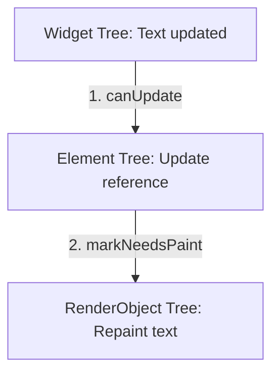
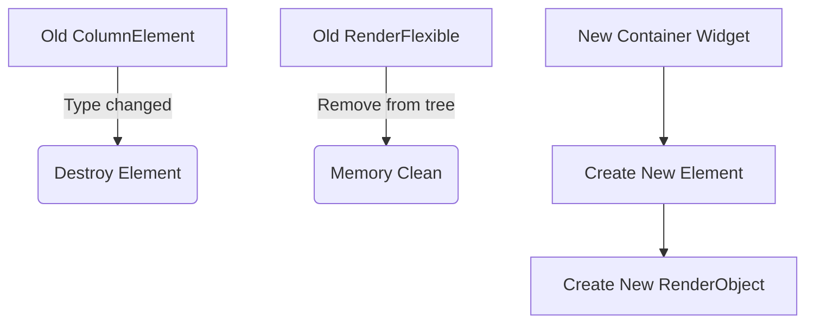

# Практична 2. Варіант 1: Три дерева Flutter

**Тема:** Технологія Flutter — взаємодія дерев Widget, Element та RenderObject

---

## 1. Поведінка дерев при зміні тексту через setState()

У початковому стані (коли `_changeType == false`) в ієрархії віджетів знаходиться `Column`, всередині якого розміщено віджет `Text`. Коли ми натискаємо на кнопку і викликаємо `setState()`, змінюється текстова змінна `_text`.

Ось що відбувається з кожним із трьох дерев фреймворку:

- **Дерево Віджетів (Widget Tree):** Ця гілка дерева перестворюється повністю. Старий об'єкт віджета `Text("Початковий текст")` знищується, а замість нього конструюється новий об'єкт `Text("Текст змінено!")`. Оскільки віджети є легковажними об'єктами, їхнє перестворення є дуже дешевою операцією.

- **Дерево Елементів (Element Tree):** Це дерево залишається стабільним. Flutter порівнює старий віджет із новим за допомогою методу `Widget.canUpdate()`. Оскільки тип віджета не змінився (був `Text` і залишився `Text`), відповідний `StatelessElement` не знищується. Він просто оновлює своє посилання на новий віджет.

- **Дерево Рендеру (RenderObject Tree):** Переживає перебудову без перестворення. Елемент сповіщає свій об'єкт рендерингу (`RenderParagraph`), що конфігурація змінилася. Рендер-об'єкт отримує новий рядок і викликає `markNeedsPaint()`. Фреймворк просто перемальовує пікселі нового тексту на екрані.

### Діаграма 1. Механізм оновлення стану (Зміна тексту)



---

## 2. Зміна типу віджета та її вплив на архітектуру

Після першого натискання прапорець `_changeType` стає `true`. Замість структури з `Column` та кнопкою повертається віджет `Container(child: Text(_text))`.

Коли Flutter знову виконує порівняння за допомогою `Widget.canUpdate()`, він виявляє критичну зміну: на тому самому місці в ієрархії замість віджета типу `Column` тепер знаходиться віджет типу `Container`. Їхні властивості `runtimeType` відрізняються.

В результаті фреймворк запускає повну процедуру деструкції:

1. Flutter **повністю знищує** існуючий `ColumnElement` та всі його дочірні елементи.
2. Старі об'єкти рендерингу (`RenderFlexible` тощо) повністю видаляються з дерева рендерингу.
3. Створюється абсолютно новий `StatelessElement` для віджета `Container`.
4. Новий елемент монтується в дерево і з нуля конструює під собою нові об'єкти рендерингу.

Це найбільш ресурсомістка операція у Flutter, оскільки фреймворку доводиться заново виділяти пам'ять і будувати зв'язки з нуля.

---

### Діаграма 2. Механізм зміни типу віджета



---

## 3. Правило перевикористання Element у Flutter

Згідно з офіційною документацією Flutter, фреймворк перевикористовує існуючий `Element` лише тоді, коли метод `canUpdate` повертає `true`:

```dart
static bool canUpdate(Widget oldWidget, Widget newWidget) {
  return oldWidget.runtimeType == newWidget.runtimeType
      && oldWidget.key == newWidget.key;
}
```

- **Element перевикористовується:** Якщо новий віджет має такий самий тип (`runtimeType`) та такий самий ключ (`key`), як і попередній віджет у тій же позиції.
- **Element НЕ перевикористовується:** Якщо типи віджетів відрізняються або якщо у віджетів одного типу відрізняються значення `key`.

_Джерело:_ Офіційна документація [Flutter API Reference — Widget — canUpdate](https://flutter.dev).

---

## Висновок

Дерево віджетів — це взагалі не графічний інтерфейс (UI), а лише тимчасовий набір конфігурацій (креслень). Справжню роботу виконують Елементи (як менеджери зв'язків) та Рендер-об'єкти (як виконавці графіки).

Для збереження високої продуктивності розробнику важливо підтримувати структуру дерева елементів максимально незмінною. Заміна типів віджетів у рантаймі призводить до важких операцій видалення та виділення пам'яті під нові Render-об'єкти.
